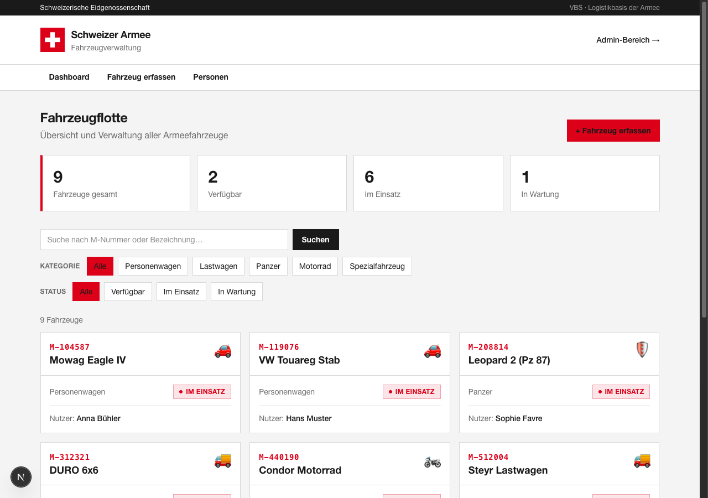
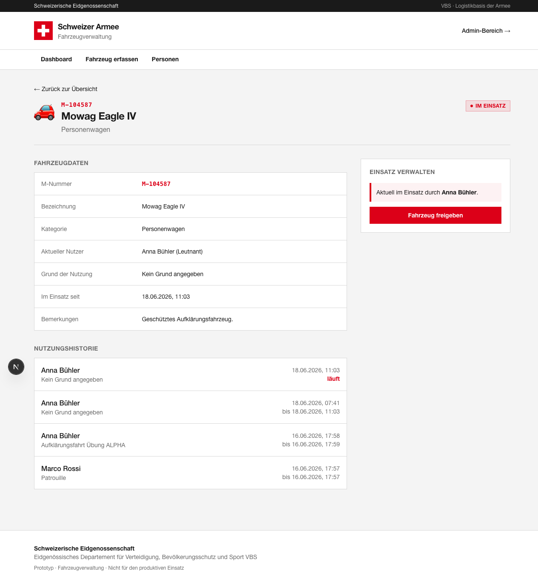
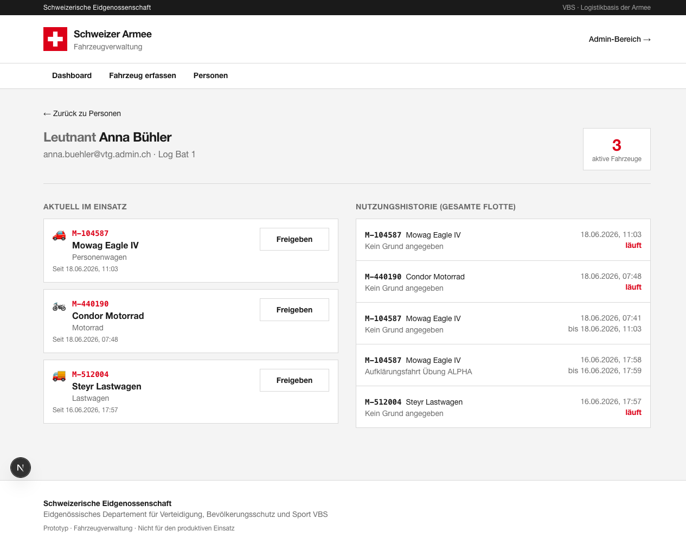
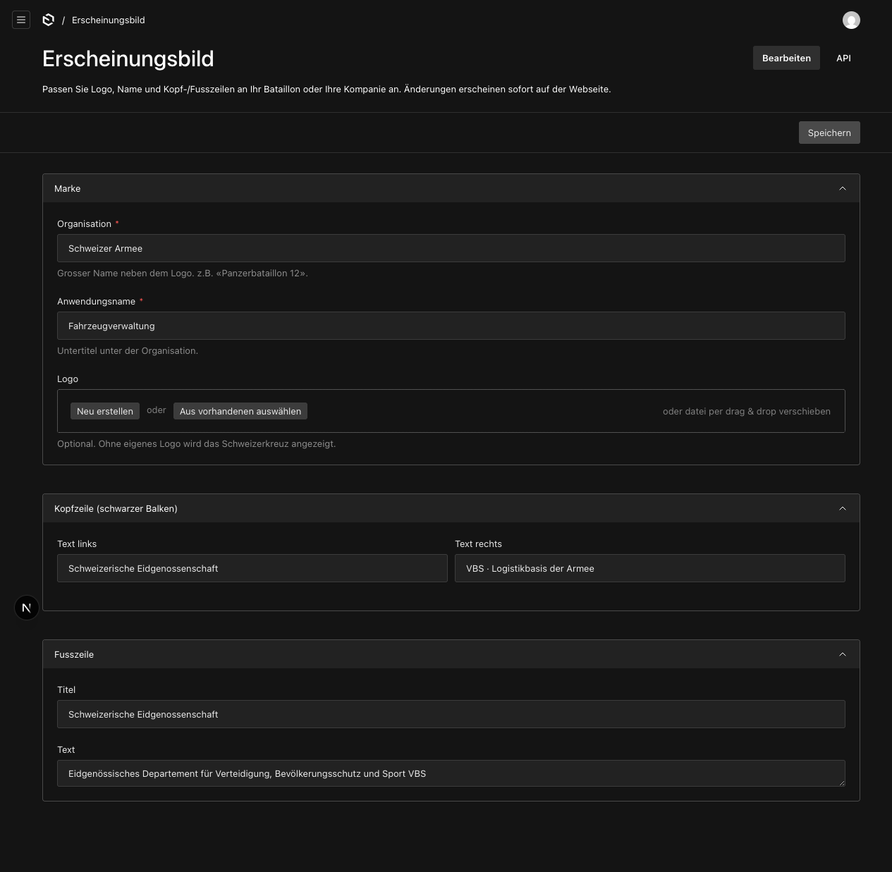

# SAF-fleet — Vehicle Fleet Manager

A simple, self-hosted web app to keep track of a fleet of vehicles and **who is
currently using which vehicle**. It was built as a prototype for managing
military vehicles (cars, trucks, tanks, motorcycles, special vehicles) identified
by an **M-number** — but it works just as well for any organisation that lends out
vehicles, machines, tools or equipment.

> 🇩🇪 **Kurz erklärt:** Eine einfache Web-Anwendung, mit der eine Einheit ihre
> Fahrzeuge verwaltet — wer hat welches Fahrzeug, seit wann und warum. Läuft auf
> einem einzelnen PC oder im internen Netz (Intranet). Logo und Beschriftung sind
> frei anpassbar.



---

## ⚠️ Important disclaimer

- This is an **independent prototype**. It is **not** affiliated with, endorsed by,
  or connected to the Swiss Armed Forces, the VBS, or the Swiss Confederation.
- The default sample branding (the name “Schweizer Armee”, the Swiss cross logo and
  the federal texts) is **placeholder demo content only**. The Swiss coat of arms and
  the Swiss cross are legally protected in Switzerland. **Replace the branding with
  your own** before any real use — this takes two minutes and needs no code (see
  [White-labelling](#-white-labelling-make-it-yours)).
- It is meant for **local / intranet use on a trusted network** — see
  [Security & where to run it](#-security--where-to-run-it).

---

## What it does

- 🚗 **Keep a vehicle list** — each vehicle has an M-number (e.g. `M-312321`), a name,
  a category and a status.
- 🏷️ **Manage your own categories** — vehicle categories are a CMS collection, so each
  unit can add, rename or re-icon them in the admin (no code needed).
- 👤 **Assign a vehicle to a person** — with an optional reason (e.g. “material transport”).
- 🔴 **See status at a glance** — *Available*, *In use*, or *In maintenance*. The status
  flips to *In use* automatically as soon as someone is assigned.
- 🕓 **Full usage history** — every assignment and return is recorded with timestamps,
  per vehicle and per person.
- 👥 **Manage people** — add the members of your unit (name, rank, unit, e-mail).
- 🚙 **One person, many vehicles** — a person can be active on several vehicles at once;
  their page bundles all active vehicles and their fleet-wide history.
- 🎨 **White-labelling** — change the logo, names and header/footer texts from the admin
  area so every unit can brand it for themselves.
- 🧹 **Reset & reseed** — wipe selected data (vehicles, people, usage history, media) or
  everything from the admin dashboard, behind a typed confirmation; optionally reload the
  sample data. The account you're logged in with is always kept.

## Screenshots

| Dashboard | Vehicle detail & assignment |
|---|---|
|  |  |

| One person, multiple vehicles | White-label settings (admin) |
|---|---|
|  |  |

## Who is this for

Small organisations, clubs, workshops, fire brigades, militia units or teams that need
a no-frills way to answer “**who has which vehicle right now, and what’s its history?**”
without paying for a cloud service or setting up a database server. Everything runs on
one computer and stores its data in a single file.

---

## 🔒 Security & where to run it

**Run this only on a single PC or inside a closed, trusted network (intranet). Never
expose it to the public internet.**

Please understand the following before using it:

- The public pages (dashboard, vehicle and people management) are **open to anyone who
  can reach the app on the network** — there is no login on those pages. Anyone on your
  network can view and change vehicle assignments and add people. Only the **admin area
  (`/admin`)** is password-protected.
- There is **no HTTPS, no rate-limiting and no hardening** for hostile environments.
- The included demo accounts use a **publicly known password** (`armee2026`). Change it
  immediately for any real use.

This design is intentional for a **trusted local/intranet tool** where everyone with
network access is allowed to use it. It is **not** suitable for the open internet.

---

## 📦 Installation (step by step)

You don’t need to be a developer, but you will use the terminal for a few commands.

### 1. Install the prerequisites (once)

- **Node.js** version 20 or newer — download from <https://nodejs.org> (the “LTS” version).
- **pnpm** (a package manager). After installing Node.js, run:
  ```bash
  npm install -g pnpm
  ```

### 2. Get the code

Download this repository as a ZIP from GitHub (green **Code** button → **Download ZIP**)
and unpack it, **or** clone it with git:

```bash
git clone https://github.com/PascalEugster/SAF-fleet.git
cd SAF-fleet
```

### 3. Install and configure

```bash
pnpm install              # download the building blocks (takes a minute)
cp .env.example .env      # create your settings file
```

Open the new `.env` file and set a long random `PAYLOAD_SECRET`. You can generate one with:

```bash
openssl rand -hex 32
```

(Paste the result after `PAYLOAD_SECRET=`. On Windows without `openssl`, just type any
long random string of letters and numbers.)

### 4. Add example data (optional but recommended)

```bash
pnpm seed
```

This creates a few sample vehicles and people **and an admin login** so you can try it
right away. Skip this step if you want to start completely empty (you can create the
first admin account by opening `/admin` in the browser).

### 5. Start the app

```bash
pnpm dev
```

Now open **<http://localhost:3000>** in your browser. 🎉

### 6. First steps

- Open the **Admin area** at <http://localhost:3000/admin>.
  - If you ran the seed, log in with **`admin@vtg.admin.ch`** / **`armee2026`**.
  - **Change this password right away** under your user in the admin.
- Make it yours: go to **Erscheinungsbild** (Branding) in the admin and set your own
  name, logo and texts — see below.

### Running it “for real” on a PC or intranet server

`pnpm dev` is the development mode. For a more permanent setup, build it once and start
the optimised version:

```bash
pnpm build
pnpm start            # serves on http://localhost:3000
```

To let other computers on your **internal network** reach it, share the host PC’s local
IP address (e.g. `http://192.168.1.50:3000`). Keep it inside your trusted network only.

**Backup:** all your data lives in the single file **`saf-fleet.db`** in the project folder.
Copy that file to back up; restore by putting it back.

---

## 🎨 White-labelling (make it yours)

Each unit can rebrand the app **without touching code**:

1. Open the admin area → **Verwaltung → Erscheinungsbild** (Branding).
2. Change any of:
   - **Organisation** name (e.g. “Panzerbataillon 12”)
   - **Application name** (the subtitle)
   - **Logo** — upload your own (falls back to the Swiss cross if empty)
   - **Header strip** texts (left/right)
   - **Footer** title and text
3. Click **Speichern** (Save). The whole site — including the browser tab title —
   updates immediately.

---

## 🧰 Tech stack

- [Payload CMS 3](https://payloadcms.com) — admin panel & content backend
- [Next.js 16](https://nextjs.org) (App Router) + React 19
- [Tailwind CSS 4](https://tailwindcss.com)
- **SQLite** via `@payloadcms/db-sqlite` — a single local file, no database server needed

### Project structure

```
src/
├── app/(frontend)/        Dashboard, vehicle/person pages + server actions
├── app/(payload)/         Payload admin panel
├── collections/           Vehicles, Users, Media
├── globals/               Branding (white-label settings)
├── components/            Header, VehicleCard, AssignPanel, UserCombobox, forms …
├── lib/                   Labels, formatting, branding helper
└── payload.config.ts      Payload configuration (SQLite, German/English admin)
```

### Useful commands

| Command | What it does |
|---|---|
| `pnpm dev` | Start in development mode (<http://localhost:3000>) |
| `pnpm build` / `pnpm start` | Build and run the optimised version |
| `pnpm seed` | Add sample data + an admin login (only if the DB is empty) |
| `pnpm generate:types` | Regenerate TypeScript types after changing collections |

---

## 🤝 Contributing

Contributions are welcome — bug reports, feature ideas, translations and code. Please
read the [contributing guide](CONTRIBUTING.md) and use the issue templates when opening
an issue. Contributions are accepted under the project's MIT license.

## 📄 License

Copyright © 2026 [inoo](https://inoo.ch).
Licensed under the **[MIT License](LICENSE.md)**.

In plain words:

- ✅ You **may** use, run, modify, share and even **sell** it, for private or commercial
  purposes — it's a permissive, OSI-approved open-source license.
- 📎 The only condition: you must keep the copyright notice and the license text with
  any copy or substantial portion you distribute.
- ⚠️ It comes **without any warranty** — use at your own risk.

See [`LICENSE.md`](LICENSE.md) for the full legal text.

---

## 🏔️ Built by inoo

SAF-fleet is developed and maintained by **[inoo](https://inoo.ch)** — a Swiss studio
building modern, self-hostable web applications.

Need a hand getting SAF-fleet running, adapting it to your unit or organisation, hosting
it on your intranet, or building something similar from scratch? We're happy to help:

- 🌐 Website: **[inoo.ch](https://inoo.ch)**
- ✉️ Contact: **[info@inoo.ch](mailto:info@inoo.ch)**

If this project is useful to you, a ⭐ on
[GitHub](https://github.com/PascalEugster/SAF-fleet) is appreciated.

---

> Prototype — not intended for production / safety-critical use. No warranty.
> Not affiliated with or endorsed by the Swiss Armed Forces or the VBS; replace the
> sample branding before any real use.
